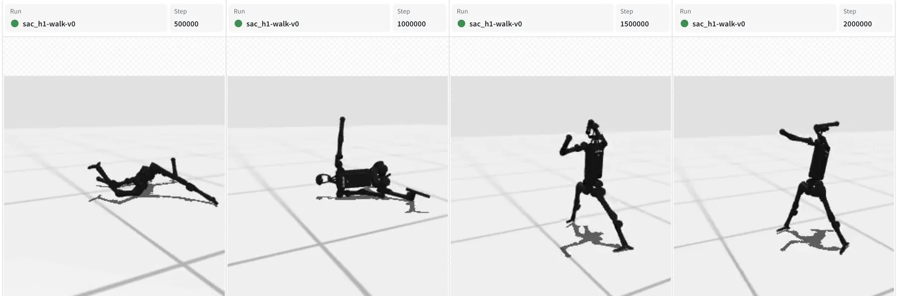

## 어떤 문제를 다루는 논문인가

본문을 적습니다. **강조**와 [논문 링크](https://arxiv.org/)를 넣을 수 있습니다.

## 핵심 아이디어

- 첫 번째 내용
- 두 번째 내용

## 직접 확인한 결과

| 조건 | 결과 |
| --- | --- |
| 기준 설정 | 실험 결과 |

이미지는 저장소의 img 폴더에 넣고 아래처럼 연결합니다.

## 읽고 남은 질문

다음에 확인할 내용을 적습니다.
