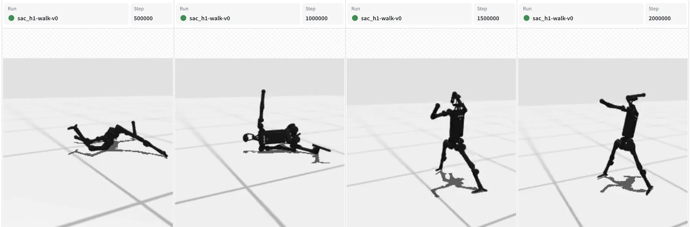

Unitree H1의 보행 과제에서 SAC, PPO, TD-MPC2, DreamerV3를 학습했습니다. 가장 중요한 발견은 로봇 설정의 불일치였습니다. 세 알고리즘은 손이 없는 H1에서 실행했고, 논문의 주요 벤치마크는 다관절 손이 달린 H1을 사용했습니다. 이 차이를 확인하면서 결과 표의 거의 모든 수치를 다시 해석해야 했습니다.

이 글에서는 HumanoidBench가 어떤 벤치마크인지 살펴보고, 직접 학습시킨 결과를 어디까지 비교할 수 있는지 정리합니다.

## HumanoidBench는 어떤 논문인가

HumanoidBench는 휴머노이드의 이동과 전신 조작 능력을 평가하기 위해 만든 시뮬레이션 벤치마크입니다. Carmelo Sferrazza, Dun-Ming Huang, Xingyu Lin, Youngwoon Lee, Pieter Abbeel이 발표했으며, 총 27개 과제를 제공합니다. 주요 실험에서는 MuJoCo 환경의 Unitree H1에 Shadow Hand 두 개를 부착합니다. 여러 과제에 걸쳐 학습 알고리즘이 고차원의 협응 제어를 얼마나 잘 수행하는지 평가합니다. [논문 III–IV절](https://arxiv.org/html/2403.10506v2)

휴머노이드가 서 있는 채로 물체를 향해 손을 뻗는 상황을 생각해 보면, 왜 전신 제어가 어려운지 이해하기 쉽습니다. 팔을 움직이면 몸에 가해지는 하중도 달라지고, 그동안 다리와 몸통은 균형을 잡아야 합니다. 손으로 무언가를 하는 과제에도 몸 전체의 협응이 필요합니다.

논문에서는 계층 구조 없이 행동을 직접 학습하는 강화학습 (flat RL)이 여러 과제에서 어려움을 겪었다고 보고합니다. 이를 보완하기 위해, 미리 학습한 저수준 스킬에 상위 정책이 목표를 전달하는 계층적 접근도 실험합니다. [공식 프로젝트의 계층적 제어 예시](https://humanoid-bench.github.io/)

## 왜 보행부터 돌려 봤나

이번 실험은 보행에 집중했습니다. 하나의 이동 과제로 범위를 좁히면 더 긴 동작 시퀀스를 다루기 전에 학습 과정을 살펴볼 수 있습니다. 물체 조작과 계층적 정책은 이번 실행 범위에 포함하지 않았습니다.

이때 환경 이름을 정확히 구분해야 합니다. 공식 저장소에서 손이 달린 H1의 보행 환경은 `h1hand-walk-v0`, 손이 없는 H1은 `h1-walk-v0`입니다. 기본 관측은 시뮬레이터의 상태 정보이며, 카메라 영상이나 촉각을 사용하려면 별도로 설정해야 합니다. [공식 환경 문서](https://github.com/carlosferrazza/humanoid-bench#environments)

따라서 “H1 보행을 학습했다”는 설명만으로는 실험 조건을 알 수 없습니다. 환경 이름과 함께 관측·행동 차원까지 확인해야 한다는 점을 이번에 배웠습니다.

## 비교한 네 가지 알고리즘

네 방법은 경험을 제어 행동으로 연결하는 방식이 다릅니다. 각 방법의 원리를 읽으며 학습 로그에서 무엇을 확인할지 정리했습니다.

- **PPO**는 정책으로 경험을 모으고 최적화 목적함수를 통해 정책 갱신을 제한합니다. 이번 실험에서는 온폴리시 베이스라인으로 사용했습니다. [PPO 논문](https://arxiv.org/abs/1707.06347)
- **SAC**는 저장한 경험을 재사용하는 오프폴리시 액터-크리틱 방법입니다. 보상을 높이는 동시에 정책의 엔트로피도 목적에 반영합니다. PPO와 경험을 사용하는 방식이 달라 학습 양상을 함께 살펴봤습니다. [SAC 논문](https://arxiv.org/abs/1801.01290)
- **TD-MPC2**는 잠재 공간에서 환경의 변화를 예측하는 월드 모델을 학습하고, 모델 예측 제어로 행동을 선택합니다. 계획 과정에 계산이 필요하므로 환경 상호작용 횟수와 실제 계산량을 함께 봐야 합니다. [TD-MPC2 논문](https://arxiv.org/abs/2310.16828)
- **DreamerV3**는 월드 모델 안에서 만들어 낸 가상의 궤적으로 행동을 학습합니다. 학습 중 리턴이 어떻게 변하는지, 잘 걷게 된 뒤에도 그 행동이 유지되는지 살펴보고자 했습니다. [DreamerV3 논문](https://arxiv.org/abs/2301.04104)

이번 실행만으로 어느 알고리즘이 휴머노이드에 가장 적합한지 결론 내리기는 어렵습니다. 우선 각 실행을 이해하고, 결과를 비교하려면 어떤 조건을 맞춰야 하는지 확인하는 데 의미를 두었습니다.

## 실험은 어떻게 진행했나

Colab A100에서 MuJoCo를 실행하고, Weights & Biases로 학습 로그를 기록했습니다. 기존 기록에 남아 있는 로봇 설정과 시드 수는 다음과 같습니다.

*알고리즘별 실험 조건*

| 알고리즘 | 로봇 설정 | 관측 / 행동 차원 | 시드 수 |
| --- | --- | --- | --- |
| PPO | 손 없음 | 51D / 19D | 3 |
| SAC | 손 없음 | 51D / 19D | 3 |
| TD-MPC2 | 손 없음 | 51D / 19D | 1 |
| DreamerV3 | 다관절 손 포함 | 151D / 61D | 1 |

아래는 SAC의 학습 중간에 저장한 정책을 실행한 모습입니다.

*왼쪽부터 0.5M, 1M, 1.5M, 2M 스텝의 SAC 정책. 넘어지던 로봇이 점차 일어서서 걷는 모습을 확인할 수 있습니다.*

이 스텝 수는 이미지에 나온 SAC 체크포인트의 학습 시점을 나타냅니다. 이 정보만으로 네 알고리즘의 학습 예산이 같았는지는 확인할 수 없습니다.

현재 정리된 기록에는 정확한 환경 커밋, 전체 실행 명령, 하이퍼파라미터, 평가 에피소드 수와 체크포인트 선택 기준이 빠져 있습니다. 다른 사람이 그대로 실행할 수 있게 하려면 원래 로그와 설정 파일에서 이 내용을 더 찾아야 합니다. 공식 저장소에 학습 명령은 공개되어 있지만, 현재 명령이 4월에 실행한 설정과 일치하는지는 아직 확인하지 못했습니다. [공식 학습 명령](https://github.com/carlosferrazza/humanoid-bench#training)

## 결과를 읽기 전에 확인할 점

아래 표는 원래 프로젝트에 기록했던 수치입니다. 여기서 리턴은 한 에피소드 동안 받은 보상의 합입니다. 과제와 평가 방법에 따라 값의 의미가 달라질 수 있습니다.

*직접 실행한 보행 실험과 논문의 결과*

| 알고리즘 | 내 실험의 최고값 | 논문 평균 | 로봇 설정 |
| --- | --- | --- | --- |
| DreamerV3 | 854.2 | 800.2 | 손 포함, 논문과 일치 |
| TD-MPC2 | 805.6 | 782.0 | 손 없음, 논문과 다름 |
| SAC | 575.3 | 31.7 | 손 없음, 논문과 다름 |
| PPO | 14.6 | 0에 가까움, 그래프 추정 | 손 없음, 논문과 다름 |

논문에서 보고한 보행 평균은 DreamerV3 800.2, TD-MPC2 782.0, SAC 31.7입니다. PPO의 참조값은 기존 기록에서 그래프를 대략 읽어 적은 값입니다. [논문 부록 C와 결과 그림](https://arxiv.org/html/2403.10506v2)

이 표를 볼 때는 **내 실험의 최고값과 논문의 평균을 나란히 놓았다는 점**부터 고려해야 합니다. 비슷한 학습 결과라도 최고값은 평균보다 높게 나올 수 있습니다. 시드 수도 다르고, 여러 시드 중 최고값을 어떻게 집계했는지도 기존 요약만으로는 알 수 없습니다. 따라서 표의 수치만으로 논문보다 성능이 좋아졌다고 판단할 수는 없습니다.

## SAC 점수는 왜 18배 높게 나왔을까

575.3을 31.7로 나누면 약 18입니다. 차이가 커서 설정을 다시 확인했고, 내 SAC 실험은 관측 51D·행동 19D의 손 없는 H1이었다는 것을 발견했습니다. 논문은 관측 151D·행동 61D의 손 있는 H1을 기준으로 합니다.

논문에도 손 유무를 비교한 실험이 있습니다. 손을 포함하면 성능이 낮아졌으며, 손의 구동만 고정하고 로봇 모델은 유지하는 조건도 실험해 행동 차원의 영향을 살펴봅니다. [논문 V-C절과 그림 6](https://arxiv.org/html/2403.10506v2)

내 결과에서는 로봇 설정이 비교에 영향을 주는 중요한 변수입니다. 다만 이것만으로 18배 차이가 전부 설명된다고 말할 수는 없습니다. 같은 알고리즘·학습 예산·평가 절차에서 로봇 설정을 의도적으로 바꾼 대조 실험이 있어야 그 영향을 확인할 수 있습니다.

TD-MPC2와 PPO도 손 없는 H1을 사용했습니다. 따라서 현재 표의 순위에는 알고리즘의 차이와 로봇 설정의 차이가 함께 섞여 있습니다.

## DreamerV3는 잘 걷다가 왜 점수가 떨어졌을까

DreamerV3는 손이 포함된 환경에서 최고 리턴 854.2를 기록한 뒤, 학습 후반에 약 233까지 떨어졌습니다. 시드는 하나만 실행했으므로, 지금 확인할 수 있는 것은 그 한 번의 학습에서 이런 변화가 있었다는 사실입니다.

로봇 설정이 논문과 같더라도 평가 방법, 학습 예산과 집계 방식까지 맞춰야 결과를 제대로 비교할 수 있습니다. 최고값이 논문 평균보다 높았다는 이유만으로 평균 성능을 재현했다고 보기는 어렵습니다.

후반 하락의 원인은 아직 찾지 못했습니다. 저장된 체크포인트를 같은 조건으로 평가하고 실제 보행 모습도 비교해 보고 싶습니다. 행동 자체가 나빠진 것인지, 평가의 변동이나 기록한 지표의 차이가 영향을 준 것인지 구분할 필요가 있습니다.

## 학습을 끝까지 돌리는 데도 어려움이 있었다

긴 서브프로세스를 실행하는 동안 Colab 세션이 중단되는 일이 있었습니다. 30초마다 로그를 남기는 스레드를 두자 세션을 유지하는 데 도움이 됐습니다. TD-MPC2는 계산 할당량이 소진되면서 중단되었고, 이어서 실행하지 못해 시드 0만 완료했습니다.

구현마다 보상을 기록하는 방식도 달랐습니다. 다음에는 저장한 정책을 공통 평가 절차로 실행하고, 각 수치가 무엇을 측정했는지 함께 남겨야겠습니다.

## 다음 실험에서는 무엇을 바꿀까

1. 기존 실행마다 환경 커밋, 실행 명령, 전체 설정과 평가 산출물을 복원합니다.
2. 평가 에피소드 수와 시드, 체크포인트 선택 기준을 정해 저장된 정책을 다시 평가합니다.
3. SAC·PPO·TD-MPC2도 DreamerV3와 같은 손 포함 환경에서 학습합니다.
4. DreamerV3는 시드를 추가하고, 동일한 학습 예산에서 평균과 결과의 편차를 학습 곡선과 함께 정리합니다.
5. DreamerV3의 점수가 떨어지기 전후에 실제 보행 행동이 어떻게 달라졌는지 살펴봅니다.

이번 실행을 통해 휴머노이드 학습을 경험하고, 벤치마크 수치를 해석할 때 확인해야 할 조건을 배웠습니다. 점수마다 환경 식별자, 로봇 모델과 집계 기준을 함께 남겨야 합니다. 이 정보를 복원하는 것이 실험을 온전히 재현 가능한 상태로 만드는 다음 단계입니다.
