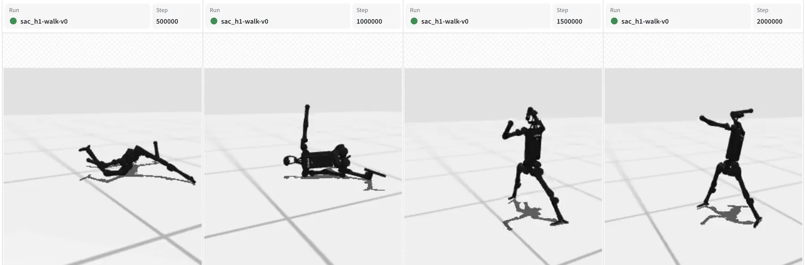

I trained SAC, PPO, TD-MPC2 and DreamerV3 on Unitree H1 walking. The most useful finding was a mismatch in the robot configuration. Three algorithms ran without hands, while the paper’s main benchmark uses dexterous hands. That changed how I could interpret almost every number in my results table.

## What HumanoidBench asks

HumanoidBench, by Carmelo Sferrazza, Dun-Ming Huang, Xingyu Lin, Youngwoon Lee and Pieter Abbeel, introduces 27 simulated tasks covering locomotion and whole-body manipulation. Its main experimental robot is a Unitree H1 with two Shadow Hands, simulated in MuJoCo. The question is how well learning methods handle coordinated, high-dimensional control across diverse tasks. [HumanoidBench paper, Sections III–IV](https://arxiv.org/html/2403.10506v2)

A useful way to read the benchmark is to imagine reaching for an object while standing. An arm movement changes the load on the body, while the feet must maintain support. A task that appears to involve one part of the robot can require coordination across the entire body.

The paper finds that flat reinforcement learning struggles on many tasks. Its hierarchical experiments provide learned low-level skills to a higher-level policy. This offers a way to reuse control skills when learning more complex behavior. [Official project and hierarchical examples](https://humanoid-bench.github.io/)

## Why start with walking?

This experiment focuses on walking. The manipulation tasks and hierarchical policies are outside the scope of these runs. Starting with one locomotion task gives me a smaller setting in which to inspect training behavior before attempting a longer sequence of coordinated actions.

The environment name deserves particular attention. The official repository lists `h1hand-walk-v0` for the main hand-equipped benchmark and `h1-walk-v0` for the robot without hands. Its default observations expose simulator state. Visual and tactile inputs require additional configuration. [Official environment documentation](https://github.com/carlosferrazza/humanoid-bench#environments)

I therefore need to report both the environment identifier and the observation/action dimensions. “H1 walking” alone leaves too much ambiguity for someone trying to compare or reproduce the experiment.

## The four learning methods

These methods offer different ways to turn experience into control. Reading their mechanisms helped me decide what to inspect in the logs.

- **PPO** collects experience under a policy and constrains policy updates through its optimization objective. I use it here as an on-policy baseline. [PPO paper](https://arxiv.org/abs/1707.06347)
- **SAC** is an off-policy actor-critic method that combines reward optimization with an entropy objective. Its reuse of stored experience makes its learning behavior useful to compare with PPO. [SAC paper](https://arxiv.org/abs/1801.01290)
- **TD-MPC2** learns a latent world model and uses model predictive control to choose actions. Its planning component raises a practical question about the relationship between environment interactions and computation. [TD-MPC2 paper](https://arxiv.org/abs/2310.16828)
- **DreamerV3** learns a world model and trains behavior using imagined trajectories. I am interested in how its return develops over training and whether the resulting behavior remains stable. [DreamerV3 paper](https://arxiv.org/abs/2301.04104)

A score from one walking setup cannot settle which method works best for humanoids overall. My immediate goal is to understand the behavior of each run and identify the conditions needed for a valid comparison.

## What I ran

The experiments used MuJoCo on Colab A100 hardware, with Weights & Biases for logging. My existing record contains the following configuration and seed counts.

*Recorded experimental setup*

| Algorithm | Robot configuration | Observation / action | Seeds |
| --- | --- | --- | --- |
| PPO | Without hands | 51D / 19D | 3 |
| SAC | Without hands | 51D / 19D | 3 |
| TD-MPC2 | Without hands | 51D / 19D | 1 |
| DreamerV3 | With dexterous hands | 151D / 61D | 1 |

The rollout image below records SAC checkpoints at 0.5M, 1M, 1.5M and 2M steps. Those labels describe this sequence of images. They do not establish a shared training budget across all four methods.

*SAC policy rollouts at 0.5M, 1M, 1.5M and 2M steps, from falling over to upright walking.*

The saved summary does not include the exact environment commit, complete launch commands, hyperparameters, evaluation episode counts or checkpoint-selection rules. I would need to recover those from the original run artifacts before this page could serve as a complete execution recipe. The official repository provides training entry points, but I have not established that its current commands match these April runs. [Official training entry points](https://github.com/carlosferrazza/humanoid-bench#training)

## Results and what the numbers mean

The values below preserve the results in my original project record. Episode return is the accumulated task reward. Its scale depends on the task and evaluation procedure.

*Walking return from my record alongside the paper’s reference values*

| Algorithm | My recorded best | Paper mean | Configuration match |
| --- | --- | --- | --- |
| DreamerV3 | 854.2 | 800.2 | Hand-equipped robot |
| TD-MPC2 | 805.6 | 782.0 | Different robot |
| SAC | 575.3 | 31.7 | Different robot |
| PPO | 14.6 | Near zero, visual estimate | Different robot |

The paper reports walking means of 800.2 for DreamerV3, 782.0 for TD-MPC2 and 31.7 for SAC. The PPO reference in my record is an approximate reading of the plotted result. [HumanoidBench, Appendix C and benchmark figures](https://arxiv.org/html/2403.10506v2)

My “best” values and the paper’s means use different aggregation. A selected peak can exceed a mean even when the underlying training performance is similar. The seed counts also differ, and the original summary does not establish how the best values were aggregated across seeds. I cannot use this table to claim an improvement over the paper.

## The SAC number that prompted a closer check

Dividing 575.3 by 31.7 gives roughly 18. That initially looked like an unusually large performance gap. Checking the setup showed that my SAC run used the 51D-observation, 19D-action robot without hands, while the reference used the 151D-observation, 61D-action hand-equipped robot.

The paper explicitly studies the effect of hands and reports lower performance with them. It also tests a full robot with hand actuation fixed, separating some effects of action dimensionality from the retained robot model. [HumanoidBench, Section V-C and Figure 6](https://arxiv.org/html/2403.10506v2)

That makes robot configuration a substantial confound in my comparison. It does not establish how much of my particular gap it explains. To measure that, I would need matched runs with the same algorithm, evaluation procedure and training budget, changing the robot configuration deliberately.

The same issue applies to my TD-MPC2 and PPO results. Their positions in this table mix algorithm differences with changes to the control problem.

## DreamerV3 and the late drop

DreamerV3 used the hand-equipped configuration and reached a recorded peak of 854.2. Its return later fell to about 233. I ran one seed, so these observations describe that run’s trajectory.

Matching the robot configuration clears one obstacle to comparison. Evaluation settings, training budget and aggregation still need to match. A peak above the paper’s mean is insufficient evidence that I reproduced its average performance.

The late drop remains unexplained in my record. Checking saved checkpoints under a fixed evaluation procedure would help distinguish a persistent loss of behavior from noisy measurements or differences in the logged metric. Those possibilities are questions for follow-up work.

## Practical constraints

Colab interrupted sessions during long subprocess runs. A thread that logged every 30 seconds helped keep my sessions active. Compute quota exhaustion also interrupted TD-MPC2, and I could not resume that run, leaving only seed 0 completed in my record.

I also recorded differences in how the training implementations reported reward. A useful follow-up is to evaluate saved policies through one explicit procedure and record the metric definition alongside each result. That would make the comparison easier to audit.

## What I would run next

1. Recover the environment commit, commands, full configurations and evaluation artifacts for each existing run.
2. Evaluate saved checkpoints with a documented episode count, seed set and checkpoint-selection rule.
3. Run SAC, PPO and TD-MPC2 on the same hand-equipped walking configuration used for DreamerV3.
4. Add DreamerV3 seeds and report a mean and spread at a fixed budget, alongside the learning curves.
5. Inspect checkpoints around the late DreamerV3 decline and compare both returns and rollout behavior.

These runs gave me experience with humanoid training and a concrete lesson in benchmark interpretation. The environment identifier, robot model and reporting rule need to travel with every score. Recovering those details is the next step toward making this experiment fully reproducible.
